

  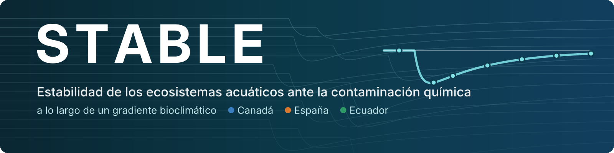

<a href="https://github.com/STABLE-uv">English</a> · <b>Español</b>

La contaminación química es una de las principales amenazas para la biodiversidad de agua dulce, pero las normas de calidad que deben protegerla proceden sobre todo de experimentos realizados en regiones templadas. **STABLE** estudia si los ecosistemas acuáticos resisten y se recuperan del estrés químico igual en todas partes, o si el clima, la composición de las comunidades y las interacciones entre especies cambian la respuesta.

Trabajamos en el [Instituto Cavanilles de Biodiversidad y Biología Evolutiva](https://www.uv.es/uvweb/cavanilles-institute-biodiversity-biology/en/introduction-1285894861820.html) (ICBiBE, Universitat de València) junto con colegas de [Wageningen University & Research](https://www.wur.nl/) (Países Bajos), la [University of Manitoba](https://umanitoba.ca/) (Canadá) y la [Universidad Regional Amazónica Ikiam](https://www.ikiam.edu.ec/) (Ecuador).

## Qué hacemos

<table>
<tr>
<td width="50%" valign="top">

### Un experimento, tres climas

**Proyecto STABLE.** Tres experimentos coordinados en mesocosmos exteriores, con un protocolo común, en una región boreal, una mediterránea y una tropical. En cada sitio se aplica un único pulso del insecticida acetamiprid a lo largo de un gradiente de siete tratamientos (de 0 a 15.000 ng/L, con tres réplicas cada uno) y se sigue durante 70 días: fitoplancton, zooplancton, macroinvertebrados, macrófitos, descomposición de la materia orgánica y metabolismo del ecosistema.

- ¿Son los ecosistemas más **sensibles** a los contaminantes en climas cálidos?
- ¿Hay un compromiso entre **resistencia, resiliencia y recuperación** a lo largo del gradiente?
- ¿Cómo se **propagan los efectos por la red trófica** a lo largo del tiempo?

Agencia Estatal de Investigación · 2026–2029

</td>
<td width="50%" valign="top">

### Aprender de los mesocosmos ya publicados

**Proyecto Leonardo.** Una base de datos de experimentos publicados en micro- y mesocosmos con plaguicidas, con las exposiciones armonizadas en unidades de peligro (*hazard units*), para cuantificar la estabilidad de poblaciones y comunidades acuáticas e identificar qué propiedades químicas y rasgos de las especies la explican.

- Modelos que predicen la **sensibilidad y la recuperación** de especies no ensayadas a partir de sus rasgos, el nivel de estrés y el modo de acción tóxico
- Modelos de estabilidad de las **comunidades y la biodiversidad** bajo estrés químico
- Base científica para fijar **umbrales de protección** de la biodiversidad de agua dulce

Beca Leonardo de la Fundación BBVA · 2025–2027

</td>
</tr>
</table>

## Cómo medimos la estabilidad

<picture>
  <source media="(prefers-color-scheme: dark)" srcset="https://raw.githubusercontent.com/STABLE-uv/.github/main/profile/img/stability-es-dark.png">
  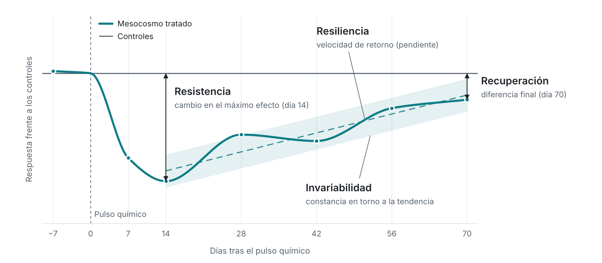
</picture>

Comparamos cada mesocosmo tratado con los controles y resumimos su respuesta con cuatro componentes complementarios, que también combinamos en un índice global de estabilidad. Los calculamos para la biomasa de los principales grupos taxonómicos, para la composición de las comunidades y para las funciones del ecosistema.

| Componente | Pregunta | Métrica |
|:--|:--|:--|
| **Resistencia** | ¿Cuánto cambia el sistema tras el pulso? | Respuesta frente a los controles en el momento de máximo efecto |
| **Resiliencia** | ¿Con qué rapidez vuelve? | Pendiente de esa respuesta en el tiempo |
| **Recuperación** | ¿Llega a parecerse a los controles? | Respuesta frente a los controles al final del experimento |
| **Invariabilidad** | ¿Cómo de regular es esa vuelta? | Inverso de la fluctuación en torno a la tendencia |

## Tres regiones bioclimáticas

| | Boreal | Mediterráneo | Tropical |
|:--|:--|:--|:--|
| **Sitio** | IISD Experimental Lakes Area, Ontario (Canadá) | Universitat de València (España) | Ikiam, Tena (Ecuador) |
| **Temperatura del agua** ¹ | 5–10 °C | 15–20 °C | 25–30 °C |
| **Experimento** | Primavera–verano 2028 | Invierno–primavera 2027 | Verano–otoño 2027 |
| **Comunidades de** | Oak Hammock Marsh | Parque Natural de l'Albufera | Reserva Biológica Colonso Chalupas |

¹ Temperatura media del agua prevista durante el experimento.

## Equipo

<picture>
  <source media="(prefers-color-scheme: dark)" srcset="https://raw.githubusercontent.com/STABLE-uv/.github/main/profile/img/map-es-dark.png">
  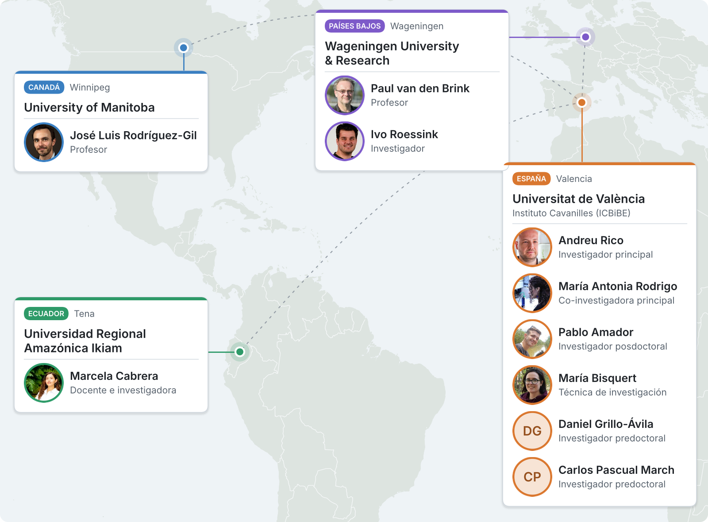
</picture>

<a href="https://github.com/STABLE-uv/.github/blob/main/profile/team-map.geojson">Mapa interactivo</a>

<!-- team:start -->
<table>
<tr>
<td width="120" align="center" valign="top">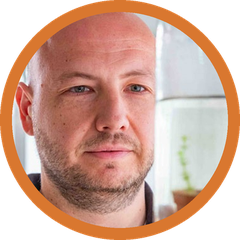</td>
<td valign="top"><b>Andreu Rico</b> Investigador principal · Universitat de València Investigador del Instituto Cavanilles de Biodiversidad y Biología Evolutiva, especializado en ecotoxicología acuática y evaluación del riesgo ambiental. Combina experimentos, seguimiento ambiental y modelización para estudiar cómo los pesticidas y otros factores de estrés afectan a la biodiversidad y al funcionamiento de los ecosistemas acuáticos.</td>
</tr>
<tr>
<td width="120" align="center" valign="top">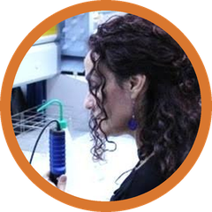</td>
<td valign="top"><b>María Antonia Rodrigo</b> Co-investigadora principal · Universitat de València Catedrática de Ecología e investigadora del Instituto Cavanilles de Biodiversidad y Biología Evolutiva. Su investigación aborda la diversidad y estabilidad de las comunidades acuáticas, las interacciones entre especies y las redes tróficas, con especial atención al papel del plancton y los macrófitos en el funcionamiento y la restauración de lagos y humedales.</td>
</tr>
<tr>
<td width="120" align="center" valign="top">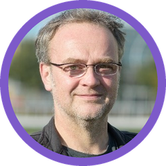</td>
<td valign="top"><b>Paul van den Brink</b> Profesor · Wageningen University &amp; Research, Países Bajos Profesor e investigador especializado en los efectos ecológicos de los contaminantes y su interacción con otras presiones ambientales. Su trabajo integra experimentos con comunidades acuáticas, modelos ecológicos y enfoques basados en rasgos para comprender y predecir las respuestas de la biodiversidad al estrés químico.</td>
</tr>
<tr>
<td width="120" align="center" valign="top"></td>
<td valign="top"><b>José Luis Rodríguez-Gil</b> Profesor · University of Manitoba, Canadá Profesor e investigador en ecotoxicología acuática y evaluación del riesgo ambiental, doctor por la University of Guelph. Estudia cómo los contaminantes y otros factores de estrés modifican la estructura y el funcionamiento de los ecosistemas acuáticos, y desarrolla métodos para incorporar este conocimiento a su gestión y protección.</td>
</tr>
<tr>
<td width="120" align="center" valign="top">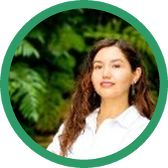</td>
<td valign="top"><b>Marcela Cabrera</b> Docente e investigadora · Universidad Regional Amazónica Ikiam, Ecuador Docente e investigadora especializada en ecotoxicología, química ambiental y calidad del agua, y responsable del Laboratorio Nacional de Referencia del Agua. Su investigación aborda la presencia y los efectos de los pesticidas en ecosistemas amazónicos, incluyendo estudios experimentales sobre la respuesta de comunidades acuáticas tropicales.</td>
</tr>
<tr>
<td width="120" align="center" valign="top"></td>
<td valign="top"><b>Ivo Roessink</b> Investigador · Wageningen University &amp; Research, Países Bajos Investigador especializado en ecología acuática, ecotoxicología y evaluación del riesgo ambiental. Su trabajo incluye experimentos en microcosmos y mesocosmos para evaluar los efectos de los pesticidas sobre organismos y comunidades acuáticas, aportando evidencia experimental para la evaluación y protección de los ecosistemas de agua dulce.</td>
</tr>
<tr>
<td width="120" align="center" valign="top">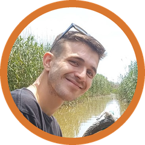</td>
<td valign="top"><b>Pablo Amador</b> Investigador posdoctoral · Universitat de València Ecólogo cuantitativo y ecotoxicólogo acuático del Instituto Cavanilles de Biodiversidad y Biología Evolutiva. Combina análisis de datos y modelización para estudiar cómo las presiones ambientales transforman la biodiversidad y el funcionamiento de los ecosistemas acuáticos. Su trabajo se centra en la ecología de comunidades, los rasgos funcionales y las distintas dimensiones de la estabilidad ecológica.</td>
</tr>
<tr>
<td width="120" align="center" valign="top">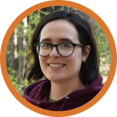</td>
<td valign="top"><b>María Bisquert</b> Técnica de investigación · Universitat de València Doctora por la Universitat de València, especializada en biodiversidad y ecología de microcrustáceos de humedales mediterráneos, con especial atención a los ostrácodos y las especies introducidas. Aporta experiencia en identificación taxonómica y estudio de comunidades acuáticas al equipo técnico del proyecto.</td>
</tr>
<tr>
<td width="120" align="center" valign="top">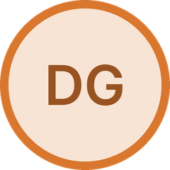</td>
<td valign="top"><b>Daniel Grillo-Ávila</b> Investigador predoctoral · Universitat de València Investigador en formación del Instituto Cavanilles de Biodiversidad y Biología Evolutiva. Utiliza experimentos en mesocosmos para estudiar los efectos directos e indirectos de los pesticidas sobre las comunidades acuáticas, prestando especial atención a cómo la presencia de macrófitos condiciona la respuesta del zooplancton y los macroinvertebrados.</td>
</tr>
<tr>
<td width="120" align="center" valign="top">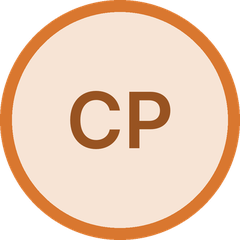</td>
<td valign="top"><b>Carlos Pascual March</b> Investigador predoctoral · Universitat de València Investigador en formación del Instituto Cavanilles de Biodiversidad y Biología Evolutiva, en el ámbito de la ecotoxicología acuática. Su trabajo incluye experimentos en mesocosmos para estudiar los efectos de los pesticidas sobre las comunidades acuáticas, contribuyendo a comprender sus respuestas a la contaminación en ecosistemas mediterráneos.</td>
</tr>
</table>
<!-- team:end -->

## Ciencia abierta

En esta organización publicamos el código del proyecto: procesado de datos y análisis estadísticos, sobre todo en R. Siguiendo el plan de gestión de datos del proyecto, los datos y el código se publican en abierto (FAIR) junto con cada artículo.

## Financiación

**STABLE** · *Estabilidad de los ecosistemas acuáticos ante la contaminación química a lo largo de un gradiente bioclimático*. Financiado por MICIU/AEI/10.13039/501100011033 y por FEDER, UE (Proyectos de Generación de Conocimiento 2025).
<!-- Añade aquí la referencia del proyecto (PID2025-…). -->

**Leonardo** · *Understanding ecological stability in a chemical stress context*. Beca Leonardo a Investigadores y Creadores Culturales 2024 de la Fundación BBVA.

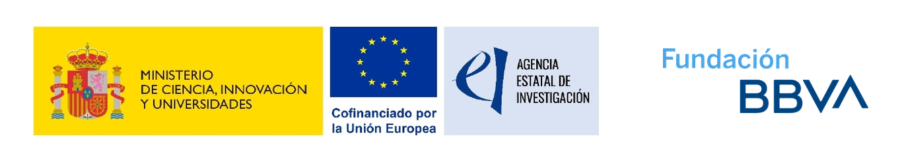

Grupo de Investigación en Limnología · Instituto Cavanilles de Biodiversidad y Biología Evolutiva · Universitat de València

