

  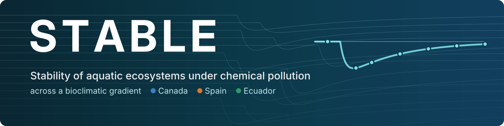

<b>English</b> · <a href="https://github.com/STABLE-uv/.github/blob/main/profile/README.es.md">Español</a>

Chemical pollution is one of the main threats to freshwater biodiversity, yet the quality standards meant to protect it come mostly from experiments run in temperate regions. **STABLE** tests whether aquatic ecosystems resist and recover from chemical stress in the same way everywhere, or whether climate, community composition and species interactions change the answer.

We are based at the [Cavanilles Institute of Biodiversity and Evolutionary Biology](https://www.uv.es/uvweb/cavanilles-institute-biodiversity-biology/en/introduction-1285894861820.html) (ICBiBE, University of Valencia, Spain) and work with colleagues at [Wageningen University & Research](https://www.wur.nl/) (Netherlands), the [University of Manitoba](https://umanitoba.ca/) (Canada) and the [Regional Amazonian University Ikiam](https://www.ikiam.edu.ec/) (Ecuador).

## What we do

<table>
<tr>
<td width="50%" valign="top">

### One experiment, three climates

**STABLE project.** Three coordinated outdoor mesocosm experiments with a common protocol, in a boreal, a Mediterranean and a tropical region. Each site receives a single pulse of the insecticide acetamiprid along a gradient of seven treatments (0 to 15,000 ng/L, three replicates each) and is followed for 70 days: phytoplankton, zooplankton, macroinvertebrates, macrophytes, organic matter decomposition and ecosystem metabolism.

- Are ecosystems more **sensitive** to chemicals in warmer climates?
- Do **resistance, resilience and recovery** trade off along the gradient?
- How do chemical effects **propagate through food webs** over time?

Spanish Research Agency (AEI) · 2026–2029

</td>
<td width="50%" valign="top">

### Learning from past mesocosm studies

**Leonardo project.** A database of published micro- and mesocosm experiments with pesticides, with exposures harmonised as hazard units, used to quantify the stability of aquatic populations and communities and to find the chemical properties and species traits behind it.

- Models that predict the **sensitivity and recovery** of untested species from their traits, the stress level and the toxic mode of action
- Models of **community and biodiversity** stability under chemical stress
- Evidence to set **protective thresholds** for freshwater biodiversity

BBVA Foundation Leonardo Grant · 2025–2027

</td>
</tr>
</table>

## How we measure stability

<picture>
  <source media="(prefers-color-scheme: dark)" srcset="https://raw.githubusercontent.com/STABLE-uv/.github/main/profile/img/stability-en-dark.png">
  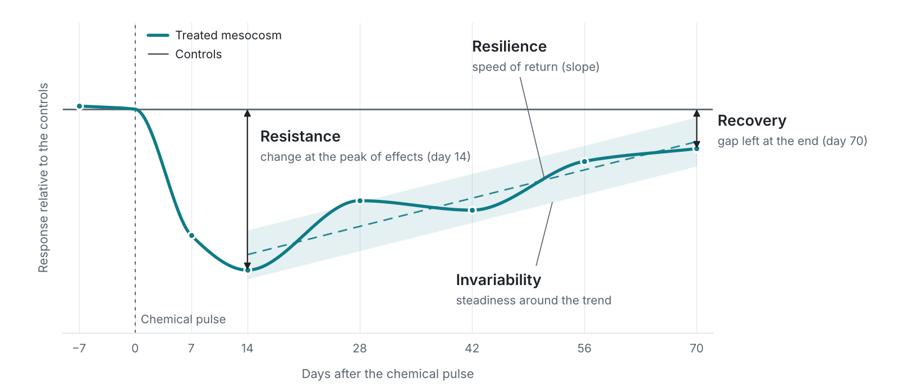
</picture>

Every treated mesocosm is compared with the controls, and its response is summarised with four complementary components that we also combine into an overall stability index. We compute them for the biomass of the main taxonomic groups, for community composition and for ecosystem functions.

| Component | Question | Metric |
|:--|:--|:--|
| **Resistance** | How much does the system change after the pulse? | Response relative to the controls at the peak of effects |
| **Resilience** | How fast does it return? | Slope of that response over time |
| **Recovery** | Does it get back to the controls? | Response relative to the controls at the end of the experiment |
| **Invariability** | How steady is the way back? | Inverse of the fluctuation around that trend |

## Three bioclimatic regions

| | Boreal | Mediterranean | Tropical |
|:--|:--|:--|:--|
| **Site** | IISD Experimental Lakes Area, Ontario (Canada) | University of Valencia (Spain) | Ikiam, Tena (Ecuador) |
| **Water temperature** ¹ | 5–10 °C | 15–20 °C | 25–30 °C |
| **Experiment** | Spring–summer 2028 | Winter–spring 2027 | Summer–autumn 2027 |
| **Communities from** | Oak Hammock Marsh | Albufera Natural Park | Colonso Chalupas Biological Reserve |

¹ Expected mean water temperature during the experiment.

## Team

<picture>
  <source media="(prefers-color-scheme: dark)" srcset="https://raw.githubusercontent.com/STABLE-uv/.github/main/profile/img/map-en-dark.png">
  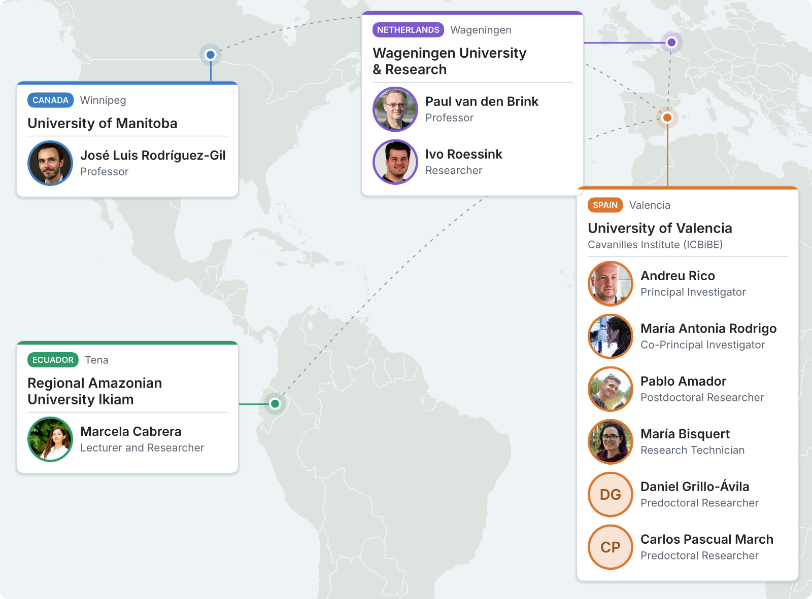
</picture>

<a href="https://github.com/STABLE-uv/.github/blob/main/profile/team-map.geojson">Interactive map</a>

<!-- team:start -->
<table>
<tr>
<td width="120" align="center" valign="top">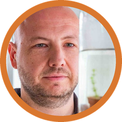</td>
<td valign="top"><b>Andreu Rico</b> Principal Investigator · University of Valencia Researcher at the Cavanilles Institute of Biodiversity and Evolutionary Biology, specialised in aquatic ecotoxicology and environmental risk assessment. He combines experiments, environmental monitoring and modelling to study how pesticides and other stressors affect the biodiversity and functioning of aquatic ecosystems.</td>
</tr>
<tr>
<td width="120" align="center" valign="top">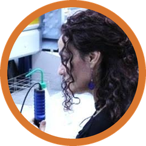</td>
<td valign="top"><b>María Antonia Rodrigo</b> Co-Principal Investigator · University of Valencia Full Professor of Ecology and researcher at the Cavanilles Institute of Biodiversity and Evolutionary Biology. Her research addresses the diversity and stability of aquatic communities, species interactions and food webs, with a focus on the role of plankton and macrophytes in the functioning and restoration of lakes and wetlands.</td>
</tr>
<tr>
<td width="120" align="center" valign="top">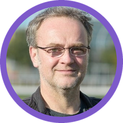</td>
<td valign="top"><b>Paul van den Brink</b> Professor · Wageningen University &amp; Research, Netherlands Professor and researcher specialised in the ecological effects of contaminants and their interaction with other environmental pressures. His work integrates experiments with aquatic communities, ecological models and trait-based approaches to understand and predict how biodiversity responds to chemical stress.</td>
</tr>
<tr>
<td width="120" align="center" valign="top"></td>
<td valign="top"><b>José Luis Rodríguez-Gil</b> Professor · University of Manitoba, Canada Professor and researcher in aquatic ecotoxicology and environmental risk assessment, with a PhD from the University of Guelph. He studies how contaminants and other stressors alter the structure and functioning of aquatic ecosystems, and develops methods to bring this knowledge into their management and protection.</td>
</tr>
<tr>
<td width="120" align="center" valign="top">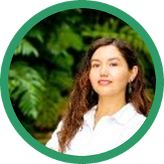</td>
<td valign="top"><b>Marcela Cabrera</b> Lecturer and Researcher · Regional Amazonian University Ikiam, Ecuador Lecturer and researcher specialised in ecotoxicology, environmental chemistry and water quality, and head of the National Water Reference Laboratory. Her research addresses the occurrence and effects of pesticides in Amazonian ecosystems, including experimental studies on the responses of tropical aquatic communities.</td>
</tr>
<tr>
<td width="120" align="center" valign="top"></td>
<td valign="top"><b>Ivo Roessink</b> Researcher · Wageningen University &amp; Research, Netherlands Researcher specialised in aquatic ecology, ecotoxicology and environmental risk assessment. His work includes micro- and mesocosm experiments to assess the effects of pesticides on aquatic organisms and communities, providing experimental evidence for the assessment and protection of freshwater ecosystems.</td>
</tr>
<tr>
<td width="120" align="center" valign="top">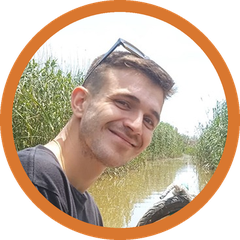</td>
<td valign="top"><b>Pablo Amador</b> Postdoctoral Researcher · University of Valencia Quantitative ecologist and aquatic ecotoxicologist at the Cavanilles Institute of Biodiversity and Evolutionary Biology. He combines data analysis and modelling to study how environmental pressures reshape the biodiversity and functioning of aquatic ecosystems. His work focuses on community ecology, functional traits and the different dimensions of ecological stability.</td>
</tr>
<tr>
<td width="120" align="center" valign="top">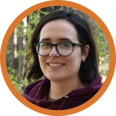</td>
<td valign="top"><b>María Bisquert</b> Research Technician · University of Valencia PhD from the University of Valencia, specialised in the biodiversity and ecology of microcrustaceans in Mediterranean wetlands, with a particular focus on ostracods and introduced species. She brings expertise in taxonomic identification and the study of aquatic communities to the project&#x27;s technical team.</td>
</tr>
<tr>
<td width="120" align="center" valign="top">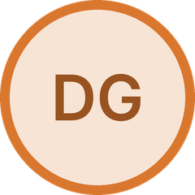</td>
<td valign="top"><b>Daniel Grillo-Ávila</b> Predoctoral Researcher · University of Valencia Early-career researcher at the Cavanilles Institute of Biodiversity and Evolutionary Biology. He uses mesocosm experiments to study the direct and indirect effects of pesticides on aquatic communities, with particular attention to how the presence of macrophytes shapes the response of zooplankton and macroinvertebrates.</td>
</tr>
<tr>
<td width="120" align="center" valign="top">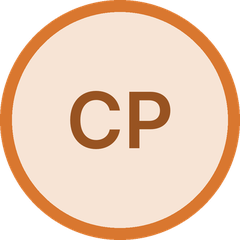</td>
<td valign="top"><b>Carlos Pascual March</b> Predoctoral Researcher · University of Valencia Early-career researcher at the Cavanilles Institute of Biodiversity and Evolutionary Biology, working in aquatic ecotoxicology. His work includes mesocosm experiments on the effects of pesticides on aquatic communities, helping to understand how they respond to pollution in Mediterranean ecosystems.</td>
</tr>
</table>
<!-- team:end -->

## Open science

This organisation hosts the project's code: data processing and statistical analyses, mostly in R. Following the project's data management plan, data and code are released openly (FAIR) together with each publication.

## Funding

**STABLE** · *Understanding the stability of aquatic ecosystems to chemical pollution across a bioclimatic gradient*. Funded by MICIU/AEI/10.13039/501100011033 and by ERDF, EU (Proyectos de Generación de Conocimiento 2025).
<!-- Add the grant reference (PID2025-…) to the line above. -->

**Leonardo** · *Understanding ecological stability in a chemical stress context*. Leonardo Grant for Researchers and Cultural Creators 2024, BBVA Foundation.

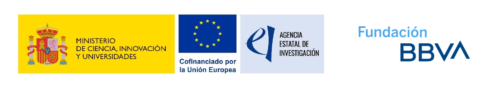

Research Group on Limnology · Cavanilles Institute of Biodiversity and Evolutionary Biology · University of Valencia

